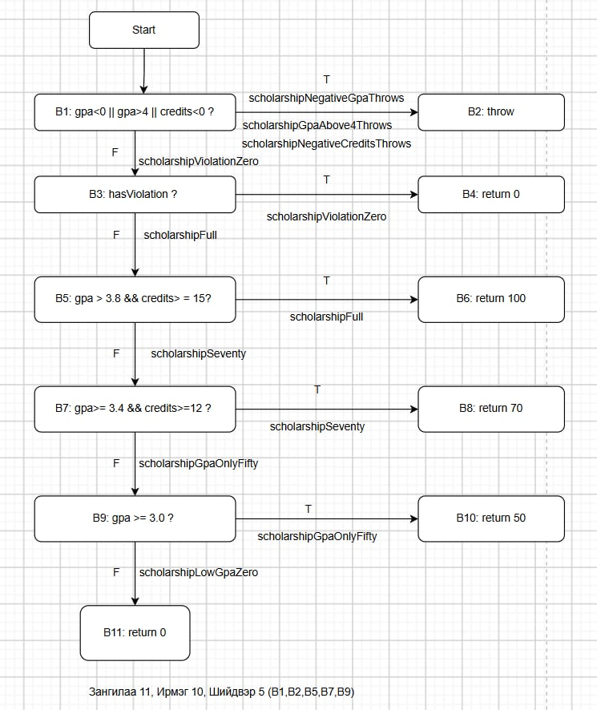

# Лаб 9: Кодын хамралт (JaCoCo)

Оюутны нэр: Ё.Болормаа
Оюутны код: B222270050

# Орчин

bolopoo@Ubuntu:~/Downloads/lab09-jacoco$ java --version
openjdk 17.0.20.1 2026-08-18
OpenJDK Runtime Environment (build 17.0.20.1+1-1-26.04-Ubuntu)
OpenJDK 64-Bit Server VM (build 17.0.20.1+1-1-26.04-Ubuntu, mixed mode, sharing)

bolopoo@Ubuntu:~/Downloads/lab09-jacoco$ mvn --version
Apache Maven 3.9.12
Maven home: /usr/share/maven
Java version: 17.0.20.1, vendor: Ubuntu, runtime: /usr/lib/jvm/java-17-openjdk-amd64
Default locale: en_US, platform encoding: UTF-8
OS name: "linux", version: "7.0.0-38-generic", arch: "amd64", family: "unix"

## Хэсэг А: Happy path ба эхний хэмжилт

ScholarshipCalculatorTest дотор хэвийн урсгалын 5 тест бичсэн: letterGradeA, gpaTwoScores, scholarshipFull, scholarshipSeventy, scholarshipViolationZero.

- Хамралт (results/jacoco-A.csv): Line 15/25 (60.0%), Branch 21/41 (51.2%)
- Тестийн үр дүн (results/mvn-verify-A.txt): Tests run: 5, Failures: 0, Errors: 0, Skipped: 0

Тайлан дээр letterGrade-ийн B, C, D, F салаа, алдаа шидэх (throw) замууд, gpa-ийн F дүн, scholarship-ийн кредит дутуу болон 50, 0 тохиолдол шар эсвэл улаан өнгөтэй байсан. Happy path тест зөвхөн гол замыг дайрдаг, алдааны болон заагийн замыг дайрдаггүй гэдгийг эндээс харсан.


## Хэсэг B: CFG ба Branch 100%

scholarship()-ийн CFG-г зурсан: 11 зангилаа, 10 ирмэг, 5 шийдвэр (B1, B3, B5, B7, B9). 



Дутуу салаануудыг нөхөх тестүүд нэмсэн: letterGrade-ийн B, C, D, F болон хоёр throw, gpa-ийн null, хоосон массив, бүх дүнгийн төрөл, scholarship-ийн гурван throw ба кредит дутуу, 50, 0 тохиолдлууд.

- Хамралт (results/jacoco-B.csv): Line 25/25 (100.0%), Branch 41/41 (100.0%). BRANCH_MISSED=0, LINE_MISSED=0.
- Тестийн үр дүн (results/mvn-verify-B.txt): Tests run: 21, Failures: 0, Errors: 0, Skipped: 0


CFG шийдвэр бүрийг нэг зангилаа гэж үздэг боловч JaCoCo || ба && доторх нөхцөл бүрийг тусад нь тоолдог. Тиймээс gpa>4, credits<0, credits>=15 ба credits>=12 нөхцөлүүдийг тус тусад нь шалгах нэмэлт тест хэрэгтэй болсон.


## Хэсэг C: Давталтын заагийн тестүүд

gpa()-ийн давталтад Лекц 9-ийн 0 / 1 / 2+ дүрмийг хэрэгжүүлсэн (ScholarshipCalculatorTest дотор):

- 0 удаа: gpaEmptyThrows (хоосон массив) ба gpaNullThrows (null), хоёулаа assertThrows-оор шалгана
- 1 удаа: gpaSingleElement, gpa([95]) == 4.0
- 2+ удаа: gpaFourElements, gpa([95,85,75,65]) == 2.5

Эдгээр тест хамралтын хувийг өсгөөгүй, учир нь давталт Хэсэг B-д аль хэдийн хамрагдсан байсан. Гэхдээ давталт 0, 1, олон удаа ажиллах гурван тохиолдол нь off-by-one болон нийлбэр хуримтлуулах алдааг тус тусад нь барьдаг тул хэрэгтэй хэвээр байна.


## Хэсэг D: 100% хамралттай ч алдаа амьд

letterGrade-ийн зааг утгын 10 тест нэмсэн: 0, 59.99, 60, 69.99, 70, 79.99, 80, 89.99, 90, 100.
Засахаас өмнө (results/mvn-test-D-fail.txt): Tests run: 33, Failures: 1, Errors: 0, Skipped: 0

Унасан тест:

```text
ScholarshipCalculatorTest.score60IsD:152 expected: <D> but was: <F>
```

Шалтгаан: ScholarshipCalculator.letterGrade дотор if (score > 60) гэж бичсэн, харин спецификаци 60-ыг D гэдэг. Засвар: > гэснийг >= болгосон (тусдаа commit).

Засварын дараа (results/mvn-verify-final.txt): Tests run: 33, Failures: 0, Errors: 0, Skipped: 0
Эцсийн хамралт (results/jacoco-final.csv): Line 25/25 (100.0%), Branch 41/41 (100.0%). BRANCH_MISSED=0, LINE_MISSED=0.

Дүгнэлт: Хэсэг B-ийн төгсгөлд Branch 100% байсан ч letterGrade(60) алдаа байсан. Хамралт нь мөр, салаа гүйцэтгэгдсэнийг харуулдаг, харин буцаасан утга зөв эсэхийг шалгадаггүй. Зөв утгыг шалгах нь тестийн assertion-ы үүрэг, зааг утгын тест тусдаа хэрэгтэй. Иймээс 100% хамралт нь алдаа байхгүй гэсэн үг биш.

Тест бичих, README бичих зэрэгт тусламж авсан ба бүх тестийг өөрөө ажиллуулж үр дүнг шалгасан.
